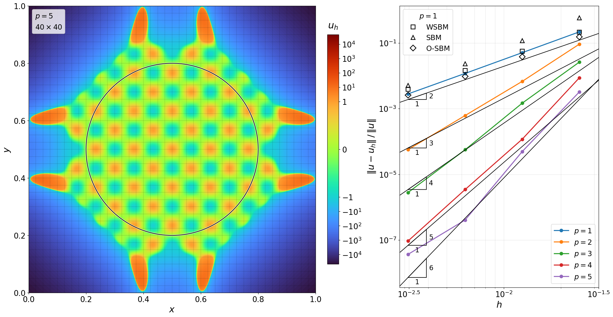
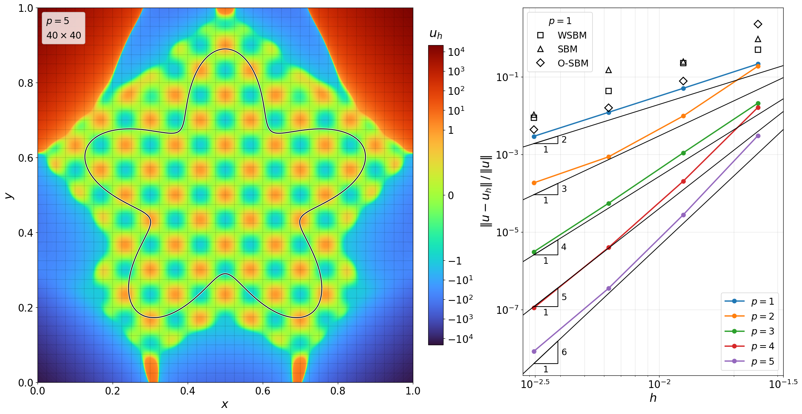
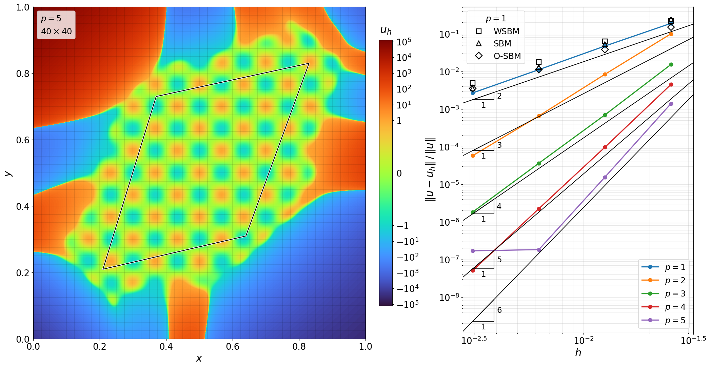
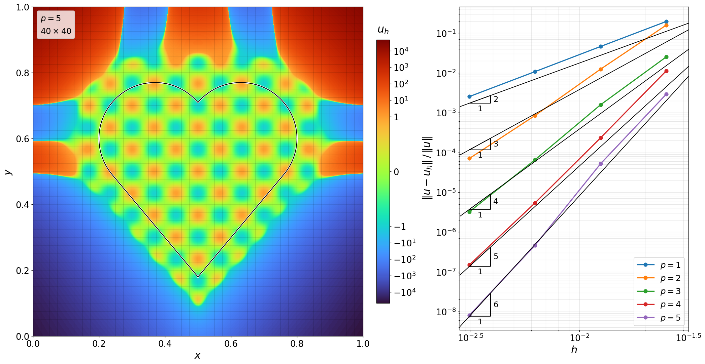
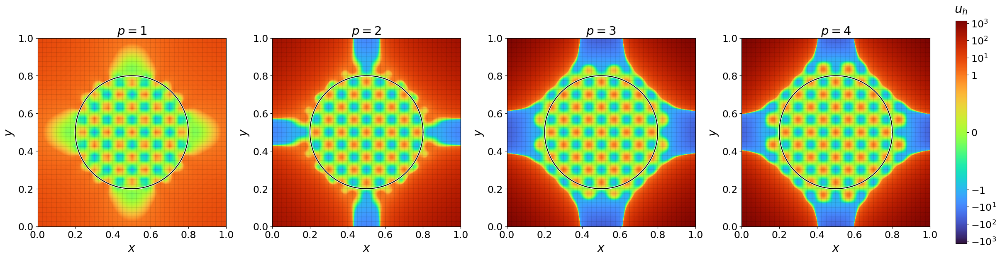
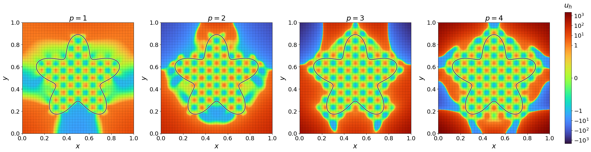
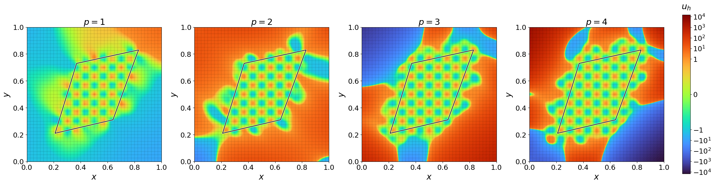
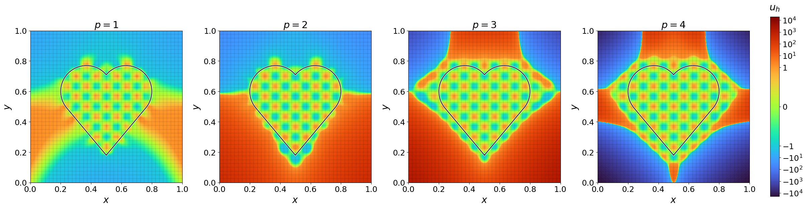
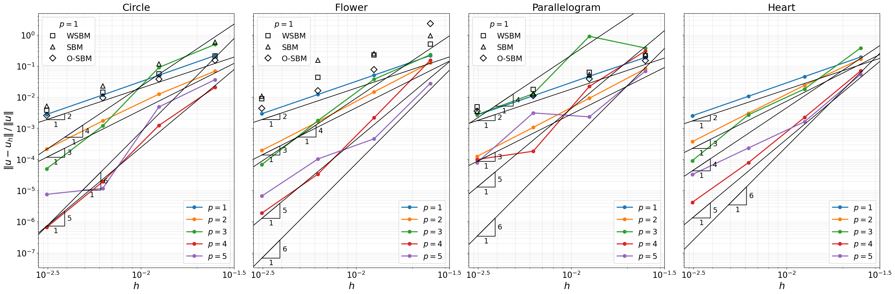
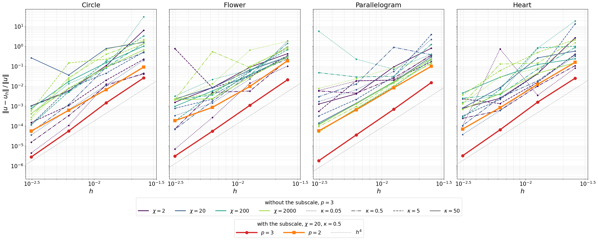

# Steady Poisson: convergence analysis (4.1.1)

We solve the steady Poisson problem, 

$$\begin{aligned}
-\Delta u &= f \qquad &\text{in } \Omega, \\
u &= g_D \qquad &\text{on } \Gamma,
\end{aligned}$$

with the manufactured solution $u = \sin(15\pi x)\sin(15\pi y)$ (Eq. 47), on four domains in the background $[0, 1]^2$, the three of [1] and a heart of our own, each given as NURBS curves:

1. **Circle** (Eq. 44): radius 0.3 around $(0.5, 0.5)$, exact as one rational quadratic curve;
2. **Flower** (Eq. 45): one closed quintic spline interpolating it at 512 points;
3. **Parallelogram** (Eq. 46): exact as four degree-1 curves, one per side;
4. **Heart**: additional geometry, to test re-entrant corners.

A background B-spline patch of degree $p$ is used on $N \times N$ knot spans, for $N = 40, 80, 160, 320$ and $h = 1/N$. Integration is exact using a Gauss-Legendre rule with $(p+1)^2$ points per span.

The **Nitsche** and **ghost penalties** are scaled with the polynomial degree as in the table below, with $\chi = 20$ and $\kappa = 0.5$: the Nitsche scaling and both values are those of [1] (Section 3.5.1 and Eq. 17), and the ghost penalty scaling is that of [2].

| | $p = 1$ | $p = 2$ | $p = 3$ | $p = 4$ | $p = 5$ |
|---|---|---|---|---|---|
| Nitsche, $\chi (p+1)^2$ | 80 | 180 | 320 | 500 | 720 |
| Ghost, $\kappa / \big((p!)^2 (2p+1)\big)$ | $1.67 \cdot 10^{-1}$ | $2.50 \cdot 10^{-2}$ | $1.98 \cdot 10^{-3}$ | $9.65 \cdot 10^{-5}$ | $3.16 \cdot 10^{-6}$ |

The standard Taylor series expansion around the surrogate boundary presented in all the SBM papers **does not provide monotonic convergence** at $p \geq 3$ GSBM. We add to it a **shifted subscale** $u'_h$, the part of the solution that the B-splines cannot represent, modelled from the residual $r_h = -\Delta u_h - f$ at the surrogate boundary and carried along the shift to the true one: $S_d^m u_h(\tilde{x}) + u'_h(x_\Gamma) = g_D(x_\Gamma)$. It vanishes with the residual of the exact solution, so the shift stays consistent.

The correction doesn't change asymptotic rates, but it reduces mesh sensiticity and error levels, giving monotone convergence under both $h$- and $p$-refinement.

## Convergence rates at $p$-degree

For B-splines of degree $p$, the optimal convergence rate in the $L^2$ norm is $p + 1$, $\Vert u - u_h \Vert = \mathcal{O}(h^{p+1})$ with $h = 1/N$.

From this folder, with Kratos on the Python path (writes `out/convergence_p<p>.csv` and the fields of the left panels). High polynomial degrees on refined meshes may be memory-intensive, you may consider removing some of them depending on your machine.


```bash
python3 convergence.py config/ProjectParameters_{circle,flower,parallelogram,heart}_taylor.json --degrees 1 2 3 4 5 --sizes 40 80 160 320 --materials "config/MaterialParameters_p{p}.json"
python3 MainKratos.py config/ProjectParameters_{circle,flower,parallelogram,heart}_taylor.json --degrees 5 --cells 40 --materials "config/MaterialParameters_p{p}.json"
python3 figures.py  # the figures of both sections
```









The $p = 1$ WSBM, SBM and O-SBM results from [1] are computed with the authors' Julia repository, [TheGeneralizedSBM.jl](https://github.com/CMOE-TUDelft/TheGeneralizedSBM.jl) [3], for the WSBM ($\alpha_h$), SBM ($\tilde{\alpha}_h$) and O-SBM ($\hat{\alpha}_h$, $\lambda = 0.5$) weights. Their absolute $L^2$ errors (Eq. 48), divided by $\Vert u \Vert$ in the figures:

| | | $N = 20$ | $N = 40$ | $N = 80$ | $N = 160$ | $N = 320$ |
|---|---|---|---|---|---|---|
| **Circle** | WSBM | $1.60 \cdot 10^{-1}$ | $5.70 \cdot 10^{-2}$ | $1.52 \cdot 10^{-2}$ | $3.87 \cdot 10^{-3}$ | $1.04 \cdot 10^{-3}$ |
|  | SBM | $3.73 \cdot 10^{-1}$ | $1.57 \cdot 10^{-1}$ | $3.16 \cdot 10^{-2}$ | $6.18 \cdot 10^{-3}$ | $1.38 \cdot 10^{-3}$ |
|  | O-SBM | $1.28 \cdot 10^{-1}$ | $4.10 \cdot 10^{-2}$ | $1.02 \cdot 10^{-2}$ | $2.55 \cdot 10^{-3}$ | $6.89 \cdot 10^{-4}$ |
| **Flower** | WSBM | $3.20 \cdot 10^{-1}$ | $1.37 \cdot 10^{-1}$ | $6.19 \cdot 10^{-2}$ | $1.18 \cdot 10^{-2}$ | $2.40 \cdot 10^{-3}$ |
|  | SBM | $1.50 \cdot 10^{0}$ | $2.55 \cdot 10^{-1}$ | $6.77 \cdot 10^{-2}$ | $4.14 \cdot 10^{-2}$ | $2.88 \cdot 10^{-3}$ |
|  | O-SBM | $9.17 \cdot 10^{-1}$ | $6.24 \cdot 10^{-1}$ | $2.12 \cdot 10^{-2}$ | $4.34 \cdot 10^{-3}$ | $1.20 \cdot 10^{-3}$ |
| **Parallelogram** | WSBM | $1.68 \cdot 10^{-1}$ | $5.06 \cdot 10^{-2}$ | $1.46 \cdot 10^{-2}$ | $4.09 \cdot 10^{-3}$ | $1.13 \cdot 10^{-3}$ |
|  | SBM | $2.23 \cdot 10^{-1}$ | $5.59 \cdot 10^{-2}$ | $1.24 \cdot 10^{-2}$ | $3.01 \cdot 10^{-3}$ | $8.11 \cdot 10^{-4}$ |
|  | O-SBM | $1.26 \cdot 10^{-1}$ | $3.51 \cdot 10^{-2}$ | $8.91 \cdot 10^{-3}$ | $2.62 \cdot 10^{-3}$ | $8.18 \cdot 10^{-4}$ |

## Ghost regions at $p$-degree

The fields at every degree on $N = 40$, written to `out/<domain>_taylor_p<p>_N40.vtk`:

```bash
python3 MainKratos.py config/ProjectParameters_{circle,flower,parallelogram,heart}_taylor.json --degrees 1 2 3 4 --cells 40 --materials "config/MaterialParameters_p{p}.json"
python3 figures.py  # the figures of both sections
```









## The standard series, without the subscale

The same benchmark with the shifted subscale off, `USE_RESIDUAL_TERMS` false in `config/MaterialParameters_standard_p<p>.json`:

```bash
python3 convergence.py config/ProjectParameters_{circle,flower,parallelogram,heart}_standard.json --degrees 1 2 3 4 5 --sizes 40 80 160 320 --materials "config/MaterialParameters_standard_p{p}.json"
python3 figures.py
```



Without the subscale, the errors jump from one mesh to the next.
At $p = 3$, with every combination of the Nitsche factor $\chi = 2, 20, 200, 2000$ and the ghost penalty factor $\kappa = 0.05, 0.5, 5, 50$, against the shift with the subscale and the factors of the table:

```bash
python3 penalties.py config/ProjectParameters_{circle,flower,parallelogram,heart}_standard.json --chi 2 20 200 2000 --kappa 0.05 0.5 5 50 --sizes 40 80 160 320
python3 figures.py
```



No combination fixes it. The best one depends on the domain, $\chi = 2$ on the circle and the flower but $\chi = 2000$ on the parallelogram.

## References

[1] O. Colomés, J. Modderman, G. Scovazzi. The generalized shifted boundary method for geometry-parametric PDEs and time-dependent domains. *Comput. Methods Appl. Mech. Engrg.* 452 (2026) 118748.

[2] S. Sticko, G. Kreiss. Higher order cut finite elements for the wave equation. *J. Sci. Comput.* (2019).

[3] O. Colomés, J. Modderman. TheGeneralizedSBM.jl: a Julia-based implementation of the Generalized Shifted Boundary Method using Gridap.jl (2025), https://github.com/CMOE-TUDelft/TheGeneralizedSBM.jl.
