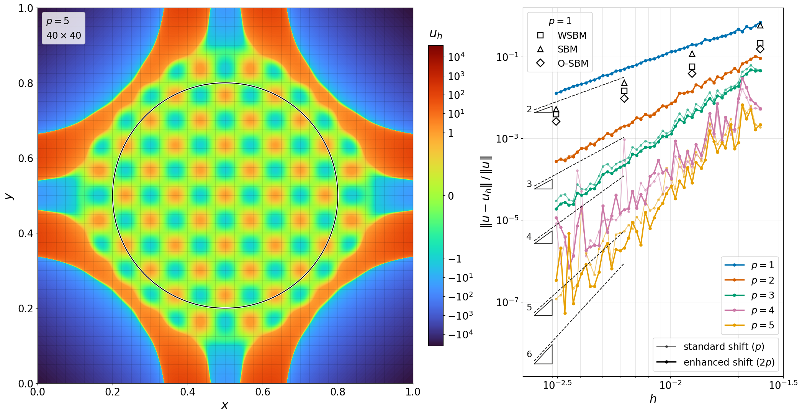
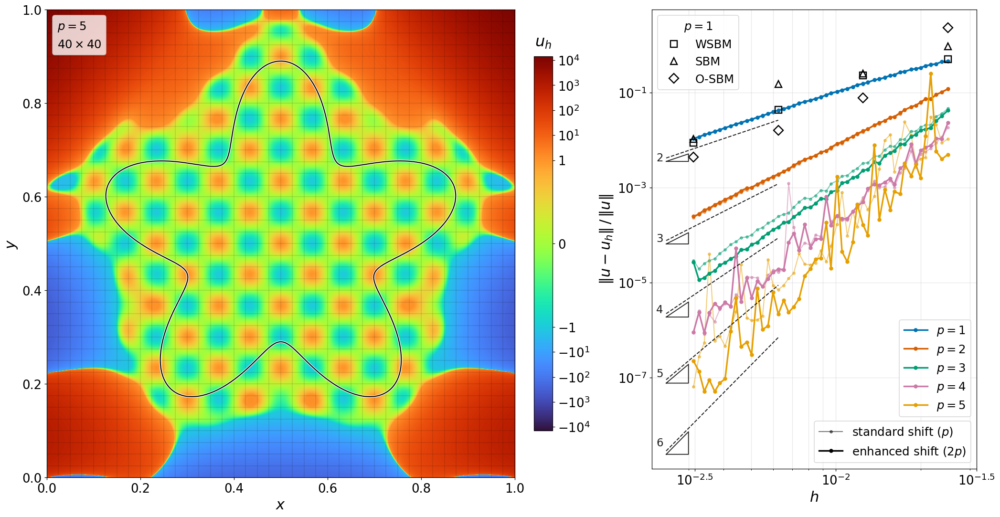
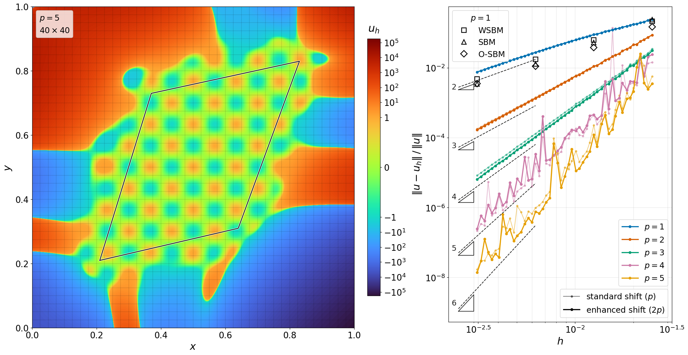
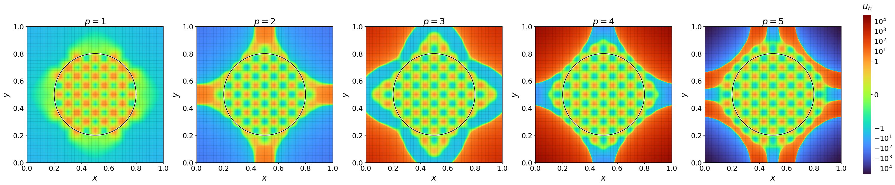
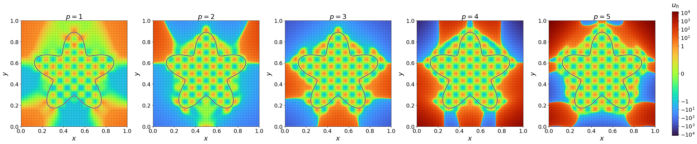
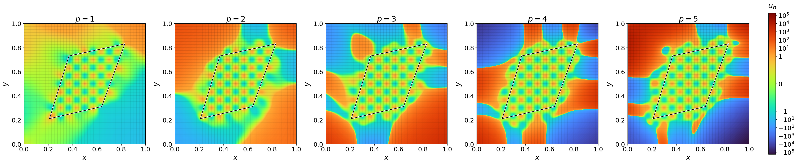
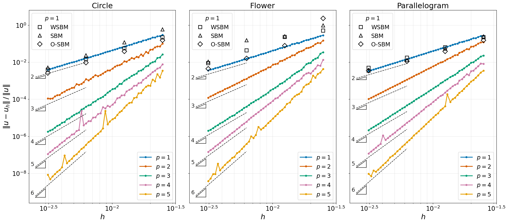

# Steady Poisson: convergence analysis (4.1.1)

We solve the steady Poisson problem, 

$$\begin{aligned}
-\Delta u &= f \qquad &\text{in } \Omega, \\
u &= g_D \qquad &\text{on } \Gamma,
\end{aligned}$$

with the manufactured solution $u = \sin(15\pi x)\sin(15\pi y)$ (Eq. 47), on the three domains of [1] in the background $[0, 1]^2$, each given as NURBS curves:

1. **Circle** (Eq. 44): radius 0.3 around $(0.5, 0.5)$, exact as one rational quadratic curve;
2. **Flower** (Eq. 45): one closed quintic spline interpolating it at 512 points;
3. **Parallelogram** (Eq. 46): exact as four degree-1 curves, one per side.

A background B-spline patch of degree $p$ is used on $N \times N$ knot spans, $h = 1/N$: for the convergence rates, the 49 meshes $N = 40 \cdot 2^{k/16}$, $k = 0, \dots, 48$, rounded, from 40 to 320, so that the boundaries cut the knot spans differently on every mesh. Integration is exact using a Gauss-Legendre rule with $(p+1)^2$ points per span.

The Dirichlet condition is imposed with the **skew-symmetric Nitsche method without penalty** [4, 5]: the adjoint term with its sign flipped, and no Nitsche penalty, as its stability does not rely on one. With the symmetric method and its penalty of [1], the errors at $p \geq 3$ jump from one mesh to the next for any penalty, as it enforces the extrapolated trace too strongly. The shift is the **enhanced operator** of [6]: the Taylor expansion of order $2p$, which for tensor-product B-splines of degree $p$ is the full one, the knot span's polynomial evaluated at the true boundary point.

The **ghost penalty** is scaled with the polynomial degree as in [2], with $\kappa = 0.5$ of [1] (Eq. 17):

| | $p = 1$ | $p = 2$ | $p = 3$ | $p = 4$ | $p = 5$ |
|---|---|---|---|---|---|
| Ghost, $\kappa / \big((p!)^2 (2p+1)\big)$ | $1.67 \cdot 10^{-1}$ | $2.50 \cdot 10^{-2}$ | $1.98 \cdot 10^{-3}$ | $9.65 \cdot 10^{-5}$ | $3.16 \cdot 10^{-6}$ |

These are `ADJOINT_FACTOR` $= -1$, `PENALTY_FACTOR` $= 0$ and `SHIFT_ORDER` $= 2p$ in `config/MaterialParameters_skew_p<p>.json`.

## Convergence rates at $p$-degree

For B-splines of degree $p$, the optimal convergence rate in the $L^2$ norm is $p + 1$, $\Vert u - u_h \Vert = \mathcal{O}(h^{p+1})$ with $h = 1/N$.

From this folder, with Kratos on the Python path (writes `out/convergence_p<p>.csv` and the fields of the left panels). High polynomial degrees on refined meshes may be memory-intensive, you may consider removing some of them depending on your machine.


```bash
OMP_NUM_THREADS=1 python3 convergence.py config/ProjectParameters_{circle,flower,parallelogram}_skew.json --degrees 1 2 3 4 5 --sizes 40 42 44 46 48 50 52 54 57 59 62 64 67 70 73 77 80 84 87 91 95 99 104 108 113 118 123 129 135 141 147 153 160 167 174 182 190 199 207 217 226 236 247 258 269 281 293 306 320 --materials "config/MaterialParameters_skew_p{p}.json"
OMP_NUM_THREADS=1 python3 convergence.py config/ProjectParameters_{circle,flower,parallelogram}_skew_unenhanced.json --degrees 1 2 3 4 5 --sizes 40 42 44 46 48 50 52 54 57 59 62 64 67 70 73 77 80 84 87 91 95 99 104 108 113 118 123 129 135 141 147 153 160 167 174 182 190 199 207 217 226 236 247 258 269 281 293 306 320 --materials "config/MaterialParameters_skew_unenhanced_p{p}.json"
python3 MainKratos.py config/ProjectParameters_{circle,flower,parallelogram}_skew.json --degrees 5 --cells 40 --materials "config/MaterialParameters_skew_p{p}.json"
python3 figures.py  # the figures of all sections
```

The convergence of the enhanced shift is drawn with a marker on every mesh, and beneath it, faded, that of the standard shift, the Taylor expansion of total order $p$ (`SHIFT_ORDER` $= p$ in `config/MaterialParameters_skew_unenhanced_p<p>.json`), with everything else the same. At $p = 1$ and $2$ the two give the same errors. From $p = 3$ the standard shift is less accurate, by a median factor of 1.2 to 1.5 at $p = 3$ and of 1.5 to 3 at $p = 5$, as [6] observes; at $p = 4$ and $5$ the errors of both jump from one mesh to the next.







The $p = 1$ WSBM, SBM and O-SBM results from [1] are computed with the authors' Julia repository, [TheGeneralizedSBM.jl](https://github.com/CMOE-TUDelft/TheGeneralizedSBM.jl) [3], for the WSBM ($\alpha_h$), SBM ($\tilde{\alpha}_h$) and O-SBM ($\hat{\alpha}_h$, $\lambda = 0.5$) weights. Their absolute $L^2$ errors (Eq. 48), divided by $\Vert u \Vert$ in the figures:

| | | $N = 20$ | $N = 40$ | $N = 80$ | $N = 160$ | $N = 320$ |
|---|---|---|---|---|---|---|
| **Circle** | WSBM | $1.60 \cdot 10^{-1}$ | $5.70 \cdot 10^{-2}$ | $1.52 \cdot 10^{-2}$ | $3.87 \cdot 10^{-3}$ | $1.04 \cdot 10^{-3}$ |
|  | SBM | $3.73 \cdot 10^{-1}$ | $1.57 \cdot 10^{-1}$ | $3.16 \cdot 10^{-2}$ | $6.18 \cdot 10^{-3}$ | $1.38 \cdot 10^{-3}$ |
|  | O-SBM | $1.28 \cdot 10^{-1}$ | $4.10 \cdot 10^{-2}$ | $1.02 \cdot 10^{-2}$ | $2.55 \cdot 10^{-3}$ | $6.89 \cdot 10^{-4}$ |
| **Flower** | WSBM | $3.20 \cdot 10^{-1}$ | $1.37 \cdot 10^{-1}$ | $6.19 \cdot 10^{-2}$ | $1.18 \cdot 10^{-2}$ | $2.40 \cdot 10^{-3}$ |
|  | SBM | $1.50 \cdot 10^{0}$ | $2.55 \cdot 10^{-1}$ | $6.77 \cdot 10^{-2}$ | $4.14 \cdot 10^{-2}$ | $2.88 \cdot 10^{-3}$ |
|  | O-SBM | $9.17 \cdot 10^{-1}$ | $6.24 \cdot 10^{-1}$ | $2.12 \cdot 10^{-2}$ | $4.34 \cdot 10^{-3}$ | $1.20 \cdot 10^{-3}$ |
| **Parallelogram** | WSBM | $1.68 \cdot 10^{-1}$ | $5.06 \cdot 10^{-2}$ | $1.46 \cdot 10^{-2}$ | $4.09 \cdot 10^{-3}$ | $1.13 \cdot 10^{-3}$ |
|  | SBM | $2.23 \cdot 10^{-1}$ | $5.59 \cdot 10^{-2}$ | $1.24 \cdot 10^{-2}$ | $3.01 \cdot 10^{-3}$ | $8.11 \cdot 10^{-4}$ |
|  | O-SBM | $1.26 \cdot 10^{-1}$ | $3.51 \cdot 10^{-2}$ | $8.91 \cdot 10^{-3}$ | $2.62 \cdot 10^{-3}$ | $8.18 \cdot 10^{-4}$ |

## Ghost regions at $p$-degree

The fields at every degree on $N = 40$, written to `out/<domain>_skew_p<p>_N40.vtk`:

```bash
python3 MainKratos.py config/ProjectParameters_{circle,flower,parallelogram}_skew.json --degrees 1 2 3 4 5 --cells 40 --materials "config/MaterialParameters_skew_p{p}.json"
python3 figures.py  # the figures of all sections
```







## The shifted subscale

The symmetric Nitsche method of [1], with its penalty $\chi (p+1)^2$, $\chi = 20$, the enhanced shift and the ghost penalty, with a **shifted subscale**: the shift rewritten with the equation. From the closest point $x_\Gamma$ on the true boundary, the solution is expanded along the line to the surrogate point $\tilde{x}$, and its derivatives along that line from the second order on are given by the equation, through the terms of its residual $r_h = -\Delta u_h - f$.



## References

[1] O. Colomés, J. Modderman, G. Scovazzi. The generalized shifted boundary method for geometry-parametric PDEs and time-dependent domains. *Comput. Methods Appl. Mech. Engrg.* 452 (2026) 118748.

[2] S. Sticko, G. Kreiss. Higher order cut finite elements for the wave equation. *J. Sci. Comput.* (2019).

[3] O. Colomés, J. Modderman. TheGeneralizedSBM.jl: a Julia-based implementation of the Generalized Shifted Boundary Method using Gridap.jl (2025), https://github.com/CMOE-TUDelft/TheGeneralizedSBM.jl.

[4] E. Burman. A penalty-free nonsymmetric Nitsche-type method for the weak imposition of boundary conditions. *SIAM J. Numer. Anal.* 50 (2012) 1959–1981.

[5] J. H. Collins, A. Lozinski, G. Scovazzi. A penalty-free Shifted Boundary Method of arbitrary order. *Comput. Methods Appl. Mech. Engrg.* 417 (2023) 116301.

[6] C. Hollweck, A. Gorgi, N. Antonelli, M. Wagner, R. Wüchner. Local $h$-, $p$-, and $k$-refinement strategies for the isogeometric shifted boundary method using THB-splines (2025), arXiv:2512.17666.
