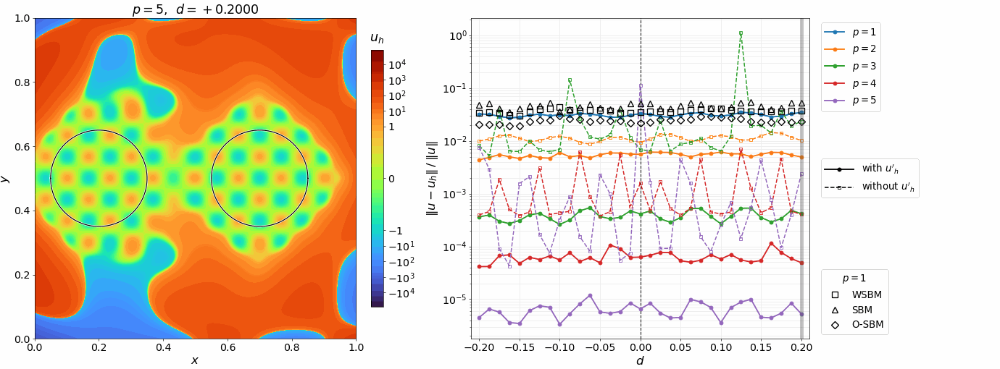
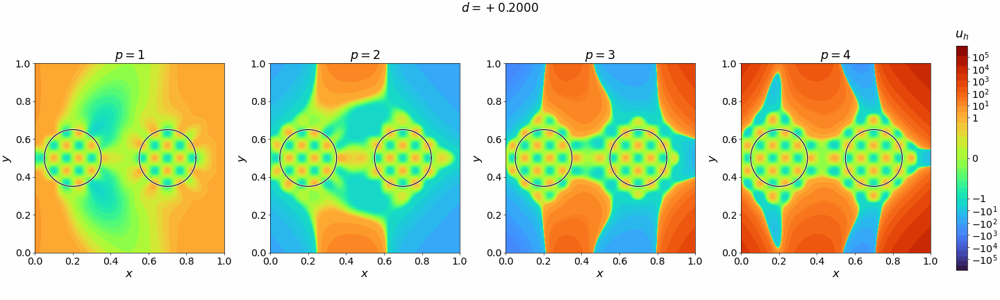

# Steady Poisson: moving boundaries (4.1.3)

The steady Poisson problem of [4.1.1](../gsbm_benchmark_4_1_1/README.md), with its manufactured solution, on two circles of radius $R = 0.15$ [1]: one fixed around $(0.2, 0.5)$, the other around $(0.5 + d, 0.5)$, for $d$ from $-0.2$ to $0.2$ in steps of $0.0125$. The circles are apart for $d > 0$, touch at $(0.35, 0.5)$ for $d = 0$, and merge for $d < 0$: the topology changes at $d = 0$. Every $d$ is a steady problem of its own, on the same background of $100 \times 100$ knot spans.

`skins.py` writes the skin of every $d$ to `config/skins/`, as exact NURBS circles: for $d \geq 0$ the two circles, and for $d < 0$ the boundary of their union, the arc of each circle outside the other, meeting at the two points where they intersect.

## Error along the sweep

From this folder, with Kratos on the Python path (writes `out/sweep_p<p>.csv` and the fields of the animation):

```bash
python3 sweep.py config/ProjectParameters_circles_taylor.json --degrees 1 2 3 4 5 --materials "config/MaterialParameters_p{p}.json"
python3 sweep.py config/ProjectParameters_circles_standard.json --degrees 1 2 3 4 5 --materials "config/MaterialParameters_standard_p{p}.json"
python3 MainKratos.py config/ProjectParameters_circles_taylor.json --degrees 5 --materials "config/MaterialParameters_p{p}.json"
python3 figures.py
```



Dashed, the same sweep without the shifted subscale, `USE_RESIDUAL_TERMS` false in `config/MaterialParameters_standard_p<p>.json`.

The $p = 1$ points are the results of [1], computed with the authors' Julia repository, [TheGeneralizedSBM.jl](https://github.com/CMOE-TUDelft/TheGeneralizedSBM.jl) [2], for the WSBM ($\alpha_h$), SBM ($\tilde{\alpha}_h$) and O-SBM ($\hat{\alpha}_h$, $\lambda = 0.5$) weights. Their absolute $L^2$ errors (Eq. 48) are in `config/reference_errors_p1.csv`, divided by $\Vert u \Vert$ in the figure.

## Ghost regions at $p$-degree

The fields at every degree on the $100 \times 100$ background, written to `out/circles_taylor_p<p>_d<d>.vtk`:

```bash
python3 MainKratos.py config/ProjectParameters_circles_taylor.json --degrees 1 2 3 4 --materials "config/MaterialParameters_p{p}.json"
python3 figures.py
```



## References

[1] O. Colomés, J. Modderman, G. Scovazzi. The generalized shifted boundary method for geometry-parametric PDEs and time-dependent domains. *Comput. Methods Appl. Mech. Engrg.* 452 (2026) 118748.

[2] O. Colomés, J. Modderman. TheGeneralizedSBM.jl: a Julia-based implementation of the Generalized Shifted Boundary Method using Gridap.jl (2025), https://github.com/CMOE-TUDelft/TheGeneralizedSBM.jl.
