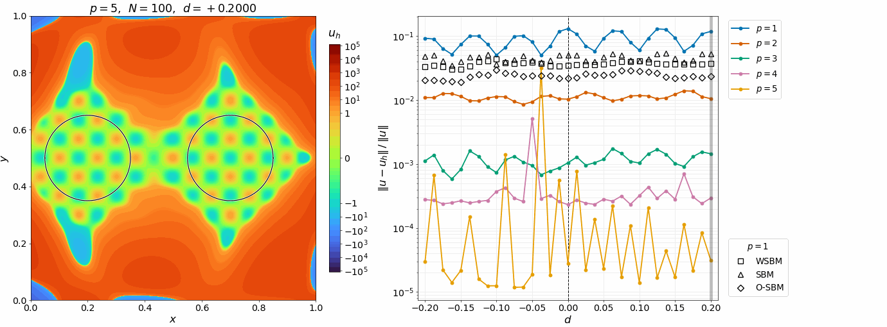
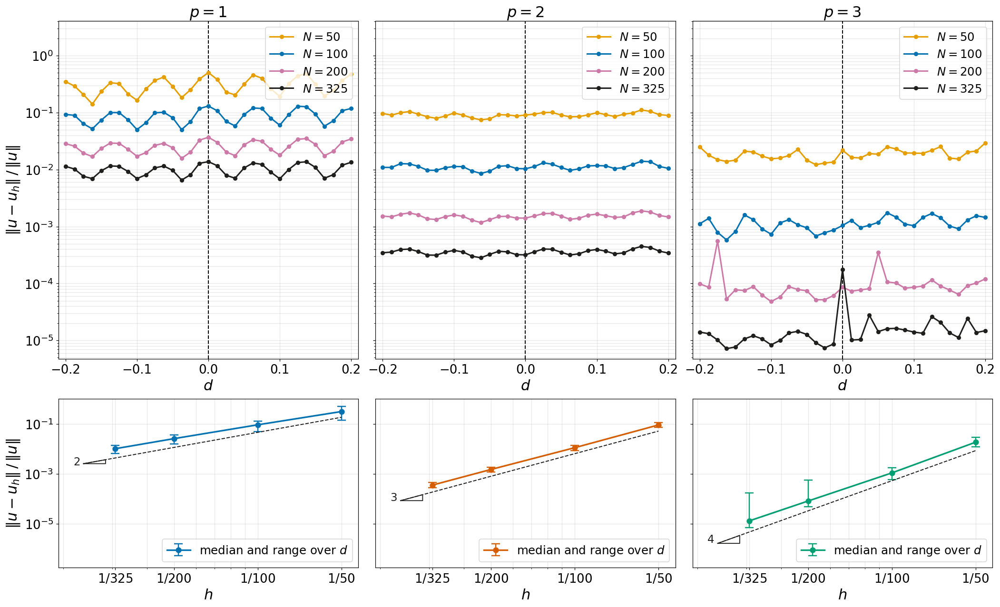
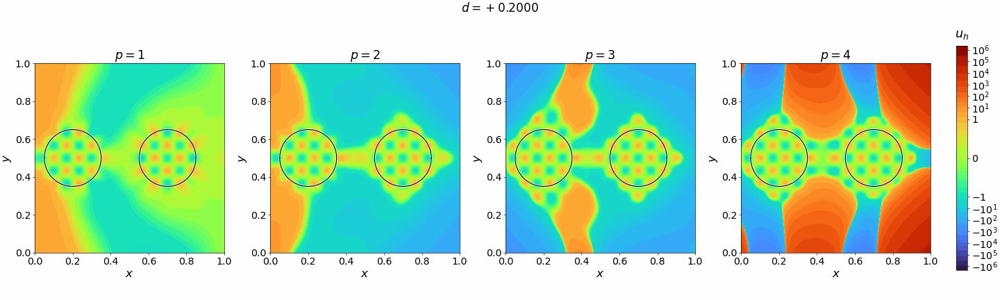
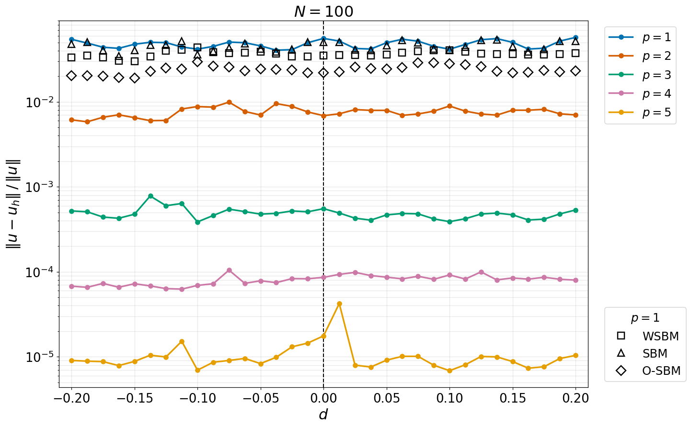

# Steady Poisson: moving boundaries (4.1.3)

The steady Poisson problem of [4.1.1](../gsbm_benchmark_4_1_1/README.md), with its manufactured solution, on two circles of radius $R = 0.15$ [1]: one fixed around $(0.2, 0.5)$, the other around $(0.5 + d, 0.5)$, for $d$ from $-0.2$ to $0.2$ in steps of $0.0125$. The circles are apart for $d > 0$, touch at $(0.35, 0.5)$ for $d = 0$, and merge for $d < 0$: the topology changes at $d = 0$. Every $d$ is a steady problem of its own, on the same background of $100 \times 100$ knot spans.

`skins.py` writes the skin of every $d$ to `config/skins/`, as exact NURBS circles: for $d \geq 0$ the two circles, and for $d < 0$ the boundary of their union, the arc of each circle outside the other, meeting at the two points where they intersect.

The method is that of 4.1.1: the skew-symmetric Nitsche method without penalty, the enhanced shift of order $2p$ and the ghost penalty $\kappa / \big((p!)^2 (2p+1)\big)$ with $\kappa = 0.5$, in `config/MaterialParameters_skew_p<p>.json`.

## Error along the sweep

From this folder, with Kratos on the Python path (writes `out/sweep_p<p>.csv` and the fields of the animation):

```bash
OMP_NUM_THREADS=1 python3 sweep.py config/ProjectParameters_circles_skew.json --degrees 1 2 3 4 5 --materials "config/MaterialParameters_skew_p{p}.json"
python3 MainKratos.py config/ProjectParameters_circles_skew.json --degrees 5 --materials "config/MaterialParameters_skew_p{p}.json"
python3 figures.py
```



The $p = 1$ points are the results of [1], computed with the authors' Julia repository, [TheGeneralizedSBM.jl](https://github.com/CMOE-TUDelft/TheGeneralizedSBM.jl) [2], for the WSBM ($\alpha_h$), SBM ($\tilde{\alpha}_h$) and O-SBM ($\hat{\alpha}_h$, $\lambda = 0.5$) weights. Their absolute $L^2$ errors (Eq. 48), divided by $\Vert u \Vert$ in the figure:

| $d$ | WSBM | SBM | O-SBM |
|---|---|---|---|
| $-0.2000$ | $5.34 \cdot 10^{-3}$ | $7.75 \cdot 10^{-3}$ | $3.28 \cdot 10^{-3}$ |
| $-0.1875$ | $5.72 \cdot 10^{-3}$ | $8.26 \cdot 10^{-3}$ | $3.34 \cdot 10^{-3}$ |
| $-0.1750$ | $5.55 \cdot 10^{-3}$ | $6.71 \cdot 10^{-3}$ | $3.33 \cdot 10^{-3}$ |
| $-0.1625$ | $5.11 \cdot 10^{-3}$ | $5.82 \cdot 10^{-3}$ | $3.24 \cdot 10^{-3}$ |
| $-0.1500$ | $5.12 \cdot 10^{-3}$ | $6.85 \cdot 10^{-3}$ | $3.23 \cdot 10^{-3}$ |
| $-0.1375$ | $5.94 \cdot 10^{-3}$ | $8.08 \cdot 10^{-3}$ | $3.98 \cdot 10^{-3}$ |
| $-0.1250$ | $7.04 \cdot 10^{-3}$ | $8.17 \cdot 10^{-3}$ | $4.39 \cdot 10^{-3}$ |
| $-0.1125$ | $7.22 \cdot 10^{-3}$ | $9.16 \cdot 10^{-3}$ | $4.31 \cdot 10^{-3}$ |
| $-0.1000$ | $7.74 \cdot 10^{-3}$ | $6.40 \cdot 10^{-3}$ | $5.23 \cdot 10^{-3}$ |
| $-0.0875$ | $6.88 \cdot 10^{-3}$ | $7.08 \cdot 10^{-3}$ | $4.75 \cdot 10^{-3}$ |
| $-0.0750$ | $6.79 \cdot 10^{-3}$ | $7.82 \cdot 10^{-3}$ | $4.65 \cdot 10^{-3}$ |
| $-0.0625$ | $6.98 \cdot 10^{-3}$ | $8.99 \cdot 10^{-3}$ | $4.30 \cdot 10^{-3}$ |
| $-0.0500$ | $7.23 \cdot 10^{-3}$ | $7.85 \cdot 10^{-3}$ | $4.52 \cdot 10^{-3}$ |
| $-0.0375$ | $6.90 \cdot 10^{-3}$ | $7.30 \cdot 10^{-3}$ | $4.49 \cdot 10^{-3}$ |
| $-0.0250$ | $6.41 \cdot 10^{-3}$ | $7.75 \cdot 10^{-3}$ | $4.47 \cdot 10^{-3}$ |
| $-0.0125$ | $6.47 \cdot 10^{-3}$ | $9.52 \cdot 10^{-3}$ | $4.15 \cdot 10^{-3}$ |
| $0.0000$ | $6.65 \cdot 10^{-3}$ | $9.63 \cdot 10^{-3}$ | $4.18 \cdot 10^{-3}$ |
| $0.0125$ | $6.75 \cdot 10^{-3}$ | $9.56 \cdot 10^{-3}$ | $4.27 \cdot 10^{-3}$ |
| $0.0250$ | $6.68 \cdot 10^{-3}$ | $7.72 \cdot 10^{-3}$ | $4.84 \cdot 10^{-3}$ |
| $0.0375$ | $6.62 \cdot 10^{-3}$ | $7.56 \cdot 10^{-3}$ | $4.66 \cdot 10^{-3}$ |
| $0.0500$ | $6.80 \cdot 10^{-3}$ | $8.75 \cdot 10^{-3}$ | $4.59 \cdot 10^{-3}$ |
| $0.0625$ | $7.16 \cdot 10^{-3}$ | $1.01 \cdot 10^{-2}$ | $4.81 \cdot 10^{-3}$ |
| $0.0750$ | $7.48 \cdot 10^{-3}$ | $9.45 \cdot 10^{-3}$ | $5.48 \cdot 10^{-3}$ |
| $0.0875$ | $7.59 \cdot 10^{-3}$ | $7.92 \cdot 10^{-3}$ | $5.43 \cdot 10^{-3}$ |
| $0.1000$ | $7.59 \cdot 10^{-3}$ | $7.71 \cdot 10^{-3}$ | $5.26 \cdot 10^{-3}$ |
| $0.1125$ | $7.31 \cdot 10^{-3}$ | $8.30 \cdot 10^{-3}$ | $5.14 \cdot 10^{-3}$ |
| $0.1250$ | $7.03 \cdot 10^{-3}$ | $1.01 \cdot 10^{-2}$ | $4.95 \cdot 10^{-3}$ |
| $0.1375$ | $6.93 \cdot 10^{-3}$ | $1.02 \cdot 10^{-2}$ | $4.37 \cdot 10^{-3}$ |
| $0.1500$ | $6.84 \cdot 10^{-3}$ | $8.44 \cdot 10^{-3}$ | $4.16 \cdot 10^{-3}$ |
| $0.1625$ | $6.80 \cdot 10^{-3}$ | $7.33 \cdot 10^{-3}$ | $4.19 \cdot 10^{-3}$ |
| $0.1750$ | $6.79 \cdot 10^{-3}$ | $7.79 \cdot 10^{-3}$ | $4.39 \cdot 10^{-3}$ |
| $0.1875$ | $6.94 \cdot 10^{-3}$ | $9.85 \cdot 10^{-3}$ | $4.26 \cdot 10^{-3}$ |
| $0.2000$ | $7.10 \cdot 10^{-3}$ | $9.89 \cdot 10^{-3}$ | $4.41 \cdot 10^{-3}$ |

## Global $h$-refinement

The same sweep at $p = 1$ to $3$ on $N = 50$, $100$, $200$ and $325$, with the same method:

```bash
OMP_NUM_THREADS=1 python3 sweep.py config/ProjectParameters_circles_skew.json --degrees 1 2 3 --cells 50 --materials "config/MaterialParameters_skew_p{p}.json" --output out/refinement_N50
OMP_NUM_THREADS=1 python3 sweep.py config/ProjectParameters_circles_skew.json --degrees 1 2 3 --cells 200 --materials "config/MaterialParameters_skew_p{p}.json" --output out/refinement_N200
OMP_NUM_THREADS=1 python3 sweep.py config/ProjectParameters_circles_skew.json --degrees 1 2 3 --cells 325 --materials "config/MaterialParameters_skew_p{p}.json" --output out/refinement_N325
python3 figures.py
```



## Ghost regions at $p$-degree

The fields at every degree on the $100 \times 100$ background, written to `out/circles_skew_p<p>_d<d>.vtk`:

```bash
python3 MainKratos.py config/ProjectParameters_circles_skew.json --degrees 1 2 3 4 --materials "config/MaterialParameters_skew_p{p}.json"
python3 figures.py
```



## The shifted subscale

As in [4.1.1](../gsbm_benchmark_4_1_1/README.md#the-shifted-subscale): the symmetric Nitsche method of [1], with its penalty $\chi (p+1)^2$, $\chi = 20$, the enhanced shift and the ghost penalty, with a **shifted subscale**: the shift rewritten with the equation, expanded from the closest point on the true boundary. It is computed at the same positions on the same background.



## References

[1] O. Colomés, J. Modderman, G. Scovazzi. The generalized shifted boundary method for geometry-parametric PDEs and time-dependent domains. *Comput. Methods Appl. Mech. Engrg.* 452 (2026) 118748.

[2] O. Colomés, J. Modderman. TheGeneralizedSBM.jl: a Julia-based implementation of the Generalized Shifted Boundary Method using Gridap.jl (2025), https://github.com/CMOE-TUDelft/TheGeneralizedSBM.jl.
