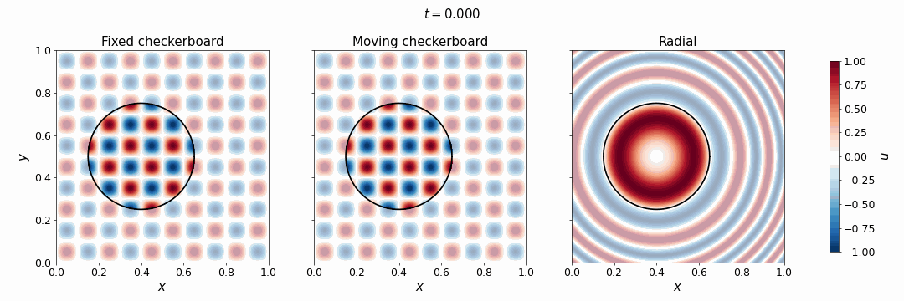
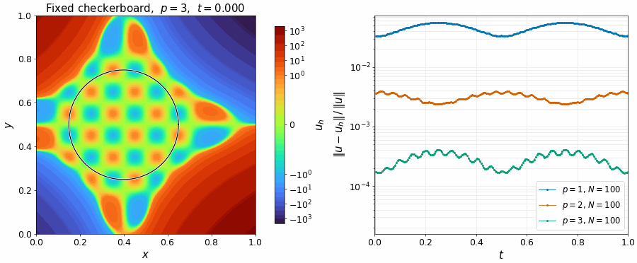
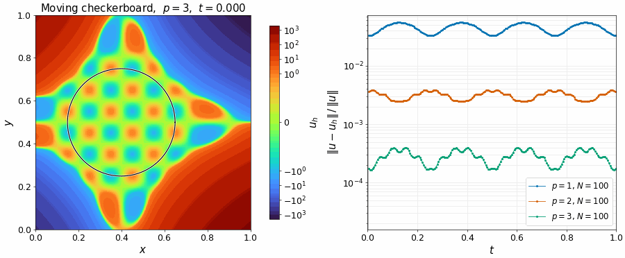
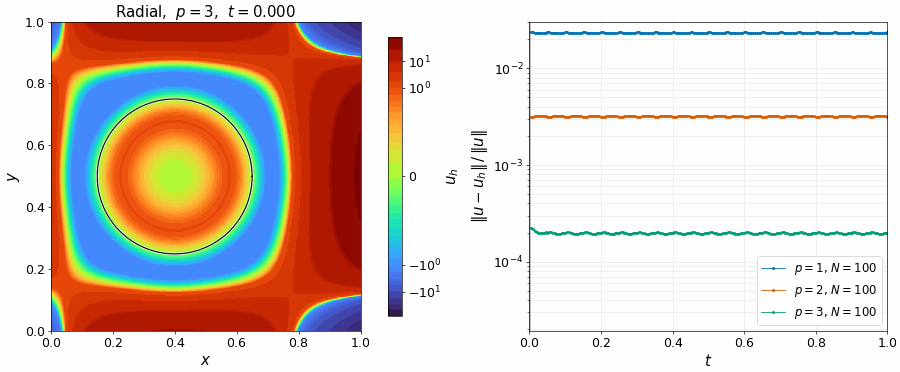

# Transient Poisson: moving boundaries

The Poisson problem of [4.1.1](../gsbm_benchmark_4_1_1/README.md) with a time derivative, on a moving domain,

$$\begin{aligned}
\partial_t u - \Delta u &= f \qquad &\text{in } \Omega(t), \\
u &= g_D \qquad &\text{on } \Gamma(t),
\end{aligned}$$

with $\Omega(t)$ a circle of radius $0.25$ around $(0.4 + 0.2\,t, 0.5)$, for $t$ from $0$ to $1$, in the background $[0, 1]^2$. It adapts the time-dependent manufactured solution of the transient Stokes problem of [1], Section 4.3.2, to the checkerboard of 4.1.1, at the frequency 10. The source $f$ and the data $g_D$ follow from each of the three cases:

1. **Fixed checkerboard:** $u = \sin(10\pi x) \sin(10\pi y)$. The solution is steady and only the boundary moves through it, which isolates the moving boundary.
2. **Moving checkerboard:** $u = \sin(10\pi (x + 0.2\,t)) \sin(10\pi y)$. The pattern moves against the circle, 2 wavelengths relative to it from $t = 0$ to $1$, so that the time derivative also matters.
3. **Radial:** $u = \sin(16\pi ((x - 0.4 - 0.2\,t)^2 + (y - 0.5)^2))$. Rings as in the solution of [1], moving with the circle: a smooth solution with one ring in the domain and $g_D = 0$.

The time derivative is second-order BDF, of order 1 at the first step, and a static solve at $t = 0$ gives the elliptic projection of the initial condition. The Dirichlet condition is imposed with the skew-symmetric Nitsche method without penalty of 4.1.1, with the enhanced shift of order $2p$ and the ghost penalty $\kappa / \big((p!)^2 (2p+1)\big)$, in `config/MaterialParameters_skew_p<p>.json`. The background is $100 \times 100$ knot spans of degree $p = 1$ to $3$, with $\Delta t = 0.005$.

From this folder, with Kratos on the Python path (writes the errors of every step to `out/<case>_p<p>_N<N>_dt<dt>.csv` as the step finishes):

```bash
OMP_NUM_THREADS=1 python3 MainKratos.py config/ProjectParameters_checkerboard_fixed.json --degrees 1 2 3 --materials "config/MaterialParameters_skew_p{p}.json"
OMP_NUM_THREADS=1 python3 MainKratos.py config/ProjectParameters_checkerboard_moving.json --degrees 1 2 3 --materials "config/MaterialParameters_skew_p{p}.json"
OMP_NUM_THREADS=1 python3 MainKratos.py config/ProjectParameters_radial.json --degrees 1 2 3 --materials "config/MaterialParameters_skew_p{p}.json"
OMP_NUM_THREADS=1 python3 MainKratos.py config/ProjectParameters_{checkerboard_fixed,checkerboard_moving,radial}.json --degrees 3 --materials "config/MaterialParameters_skew_p{p}.json" --output out/fields --fields 5
python3 figures.py
```

The fourth command repeats $p = 3$ with the fields every 5 steps, for the animations below, and writes about 500 MB to `out/fields/`.

The manufactured solutions, the field faded outside the moving circle:



## Results

**Time integration.** We use the second-order backward differentiation formula (BDF2). The control points stay fixed on the background, so the time derivative at $t^{n+1}$ combines the values of the same control points at the last three steps:

$$\partial_t u_h^{n+1} \approx \frac{3 u_h^{n+1} - 4 u_h^{n} + u_h^{n-1}}{2 \Delta t}.$$

At the first step there is no $u_h^{-1}$, so it is implicit Euler, $(u_h^{1} - u_h^{0}) / \Delta t$. The starting solution $u_h^{0}$ is one steady solve at $t = 0$. We use it because spline control points are not values of the solution, so $u(\cdot, 0)$ cannot be assigned to them directly. A knot span entering the domain takes its previous values from the extension by the ghost penalty, so it needs no special treatment.

**Error in time.** At every time step we measure the error as in 4.1.1, Eq. (48) of [1], with the volume fractions at that time:

$$\Vert e^n \Vert^2 = \sum_K \alpha_K(t^n) \int_K \big(u(t^n) - u_h^n\big)^2 \, \mathrm{d}\Omega, \qquad \Vert u^n \Vert^2 = \sum_K \alpha_K(t^n) \int_K u(t^n)^2 \, \mathrm{d}\Omega.$$

Over the $N$ time steps, these combine into the discrete $L^2$ norm in time, Eq. (54) of [1], relative to that of $u$:

$$\frac{\Vert e \Vert_{L^2(L^2)}}{\Vert u \Vert_{L^2(L^2)}} = \left( \frac{\sum_{n=1}^{N} \Delta t \, \Vert e^n \Vert^2}{\sum_{n=1}^{N} \Delta t \, \Vert u^n \Vert^2} \right)^{1/2}.$$

The static solve at $t = 0$ is not counted.







## References

[1] O. Colomés, J. Modderman, G. Scovazzi. The generalized shifted boundary method for geometry-parametric PDEs and time-dependent domains. *Comput. Methods Appl. Mech. Engrg.* 452 (2026) 118748.
